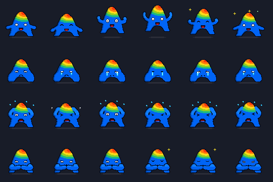
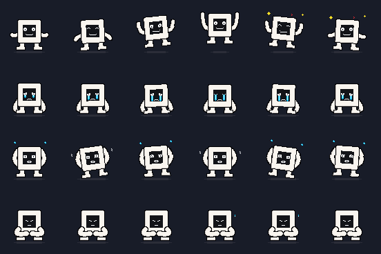
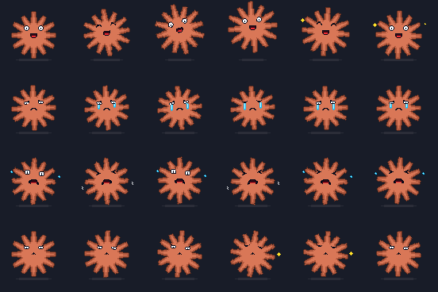
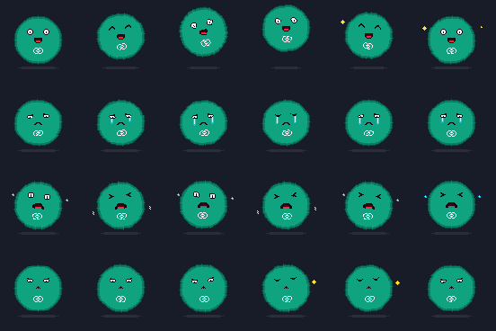
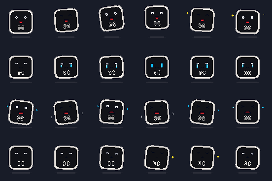

# Pet virtual — redesenho procedural

Cinco mascotes **desenhados por código**, não recortados:
**antigravity** (o A com arco-íris), **opencode** (o monitor branco),
**claude** (a estrela coral), **openai** (a bolha verde com o nó) e
**commandcode** (o terminal preto com o glifo de comando).
Python 3.10+; nenhuma dependência obrigatória. A animação usa ANSI truecolor e
meio-blocos, compatíveis com Ghostty.

## Rodar

```bash
python3 pet.py
python3 pet.py --demo
python3 pet.py --pet opencode --demo --rows 36
python3 pet.py --pet opencode --expression 4 --rows 42
python3 pet.py -s concentrado --rows 36
python3 pet.py -s comemorando --expression 4 --rows 42
python3 pet.py --export saida/ --rows 42
```

- Sem seleção individual, abre uma **grade animada com os cinco pets e as quatro
  emoções**. Cada célula identifica o pet e o estado; todos animam em sincronia.
- A grade ajusta colunas e tamanho ao terminal na abertura. Nela, `--rows`
  define a altura máxima por pet; `--fps` e `--expression` também funcionam.
- `--pet`, `--state`, `--demo`, `--state-file` ou `--export` selecionam o modo
  individual anterior; nesse modo, antigravity continua sendo o pet padrão.
- `--pet` aceita `antigravity`, `opencode`, `claude`, `openai` ou `commandcode`.
- Grade de desenho **84×84 pixels**; tamanho nativo: 84 colunas × 42 linhas.
- Tamanho automático considera altura e largura do terminal. `--rows` permite
  ampliar/reduzir mantendo a proporção; escolha um tamanho que caiba na janela.
- `--expression 1..4` escolhe o rosto sem trocar a pose. A expressão 1 acompanha
  piscadas da animação; as demais selecionam variações do mesmo estado.
- `--demo` alterna os quatro estados a cada três ciclos de seis frames.
- `--fps 6.5` controla a velocidade.
- Escreva um estado em `~/.ghostty_pet.state` para controlá-lo externamente;
  `--state-file CAMINHO` escolhe outro arquivo.
- Ctrl+C restaura o cursor e retorna à tela anterior do terminal.
- `--export` grava 24 arquivos ANSI da expressão selecionada (sobrescreve nomes iguais).

## Como o desenho funciona

O compositor está em `notutil/pets.py`; `pet.py` é a entrada da galeria:
- `BODY`: perfil desenhado à mão, topo arredondado e pernas integradas.
- `POSES`: salto, compressão e inclinação para cada um dos 24 frames.
- `thermal`: seis cores em faixas chapadas, do topo quente ao azul do rosto.
- `arm`: braços curvos com encaixe na silhueta; gestos por frame, sem percorrer
  arbitrariamente os rótulos numéricos da cartela como uma sequência temporal.
- `face`: olhos e bocas em bitmaps próprios, quatro variações por emoção.
- Pupilas centralizadas e alinhadas nos dois olhos; arcos fechados nas piscadas.
- Abaixo de 28 linhas por pet, os olhos abertos usam desenho compacto sem
  micropupilas. A redução preserva o branco dos olhos quando ocupa pelo menos
  25% de um bloco opaco, sem tornar pixels transparentes em ruído.
- Lágrimas ligadas às pálpebras, com brilho e filetes que crescem e recuam no ciclo.
- A sombra lateral do antigravity escurece cada cor do arco-íris, preservando
  as faixas ao redor da cabeça; não aplica azul sobre as cores quentes.
- Sombra no chão independente do salto; brilho e suor por estado.

O corpo e os braços externos compartilham o contorno; os braços de
“concentrado” ficam à frente. A transformação é aplicada ao corpo e ao rosto.
Amostragem inversa compartilhada por rosto e monitor evita buracos ao inclinar ou
esticar. Olhos e bocas usam o mesmo eixo central do corpo.
Os ciclos têm preparação, ação e retorno: salto com antecipação e aterrissagem,
respiração discreta na tristeza/concentração e balanço bilateral no desespero.
As sombras de todos os pets usam a mesma faixa de chão e diminuem durante o salto.

Não há leitura de PNG, Pillow, ffmpeg ou dados extraídos no runtime.
A versão anterior de recorte (`pet_frames.py` e seu gerador) foi removida.
Os assets de referência e o script que os fraciona foram preservados.
O monitor é desenhado por `render_monitor_frame`: gabinete quadrado branco,
tela escura com rostos monocromáticos, sapatos e braços separados.
Corpo, rosto e membros giram juntos; a sombra permanece no chão.
Os três mascotes novos usam o compositor comum `render_procedural_frame`:
a estrela coral desenha 12 raios e o disco central, a bolha verde desenha o
círculo com o nó branco e o terminal desenha o quadrado arredondado com o glifo.
`_face_layer` fornece o mesmo rosto às cinco silhuetas; só a cor da pupila muda.
Cada corpo tem rotação, salto e compressão próprios por estado e frame.
Todos os cinco pets têm 4 estados × 6 frames × 4 expressões.
A sombra do arco-íris não tem mais os pixels isolados acima e abaixo da faixa central.

## Conferir visualmente

### Antigravity



Linhas: comemorando, triste, desesperado, concentrado. Colunas: F1–F6.
[Expressão 4](../previews/pet-expressoes-4.png).

### OpenCode



[Expressão 4 do monitor](../previews/monitor-expressoes-4.png).

### Claude, OpenAI e CommandCode





```bash
python3 scripts/preview_pet.py previews/pet-procedural.png
python3 scripts/preview_pet.py previews/pet-expressoes-4.png --expression 4
python3 scripts/preview_pet.py previews/monitor-procedural.png --pet opencode
python3 scripts/preview_pet.py previews/monitor-expressoes-4.png --pet opencode --expression 4
python3 scripts/preview_pet.py previews/claude-procedural.png --pet claude
python3 scripts/preview_pet.py previews/openai-procedural.png --pet openai
python3 scripts/preview_pet.py previews/commandcode-procedural.png --pet commandcode
python3 -m unittest discover -s tests -v
```

Para conferir o resultado real em matrizes menores:
```bash
python3 scripts/preview_pet.py previews/antigravity-16.png --rows 16
python3 scripts/preview_pet.py previews/opencode-16.png --pet opencode --rows 16
```

O preview também usa somente a biblioteca padrão e desenha os mesmos frames
do terminal; é uma saída do compositor, não uma imagem de referência.
Os testes cobrem 480 combinações (96 por pet), limites, transparência, expressões distintas,
escala, exportação sem site-packages, validação CLI e restauração do terminal.
Também verificam a simetria da silhueta em repouso, continuidade na emenda dos
ciclos, paleta reduzida, lágrimas conectadas e ampliação sem buracos.

O resultado é uma interpretação procedural da referência, não uma reprodução
pixel a pixel. Reduzir muito a altura sacrifica detalhes do rosto; aumentar
`--rows` amplia o desenho de 84×84, não cria novos detalhes.
